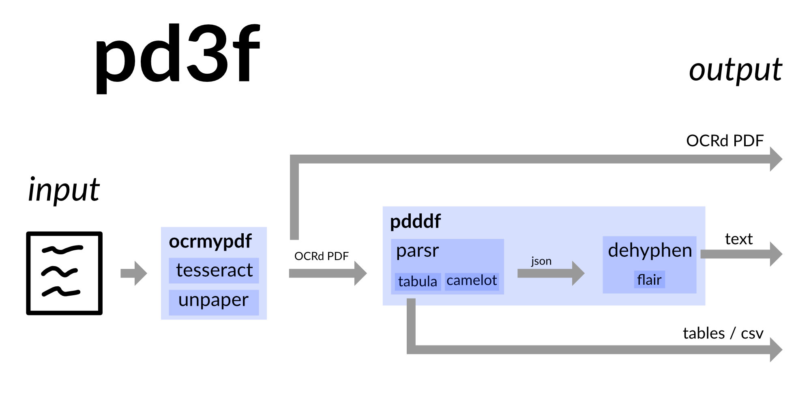
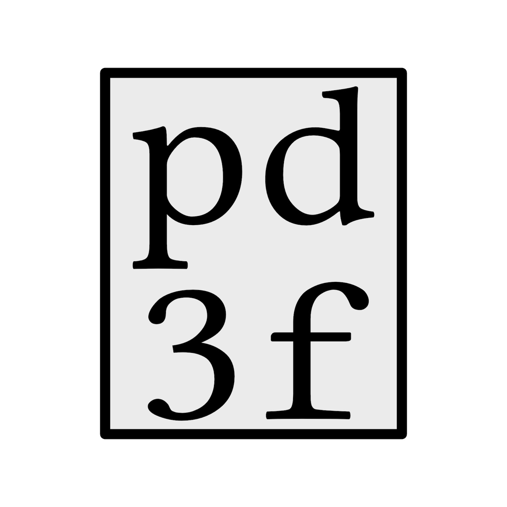

# `pd3f`

*Experimental, use with care.*

`pd3f` is a PDF **text extraction** pipeline that is self-hosted, local-first and Docker-based.
It **reconstructs** the original **continuous text** with the help of **machine learning**.

`pd3f` can OCR scanned PDFs with [OCRmyPDF](https://github.com/ocrmypdf/OCRmyPDF) (Tesseract) and extracts tables with [Camelot](https://github.com/camelot-dev/camelot) and [Tabula](https://github.com/tabulapdf/tabula).
It's built upon the output of [Parsr](https://github.com/axa-group/Parsr).
Parsr detects hierarchies of text and splits the text into words, lines and paragraphs.

Even though Parsr brings some structure to the PDF, the text is still scrambled, i.e., due to hyphens.
The underlying Python package [pd3f-core](https://github.com/pd3f/pd3f-core) tries to reconstruct the original continuous text by removing hyphens, new lines and / or spaces.
It uses [language models](https://machinelearningmastery.com/statistical-language-modeling-and-neural-language-models/) to guess how the original text looked like.

`pd3f` is especially useful for languages with long words such as German.
It was mainly developed to parse German letters and official documents.
Besides German `pd3f` supports English, Spanish, French and Italian.

`pd3f` includes a Web-based GUI and a [Flask](https://flask.palletsprojects.com/)-based microservice (API).
You can find a demo at [demo.pd3f.com](https://demo.pd3f.com).

## Documentation

Check out the full documentation at: <https://pd3f.com/docs/>

## Quick start

You need [Docker](https://docs.docker.com/get-docker/) with Docker Compose.

```bash
git clone https://github.com/pd3f/pd3f
cd pd3f
./prod.sh
```

Then open <http://localhost:1616>.
The first start downloads about 10 GB of Docker images, the first job downloads the language models.

`./prod.sh` runs the published `pd3f/pd3f` and `pd3f/pd3f-ocr` images with gunicorn and an [RQ dashboard](https://github.com/Parallels/rq-dashboard) at <http://localhost:9181/dashboard/>.
The dashboard has no login and is only reachable from the host itself.
`./dev.sh --build` builds both images from this checkout and runs Flask's development server with the code mounted into the containers.
Both pass further arguments to `docker compose up`, e.g. `-d` or `--scale worker=2`.
To update, run `git pull` and `docker compose -f docker-compose.yml -f docker-compose.prod.yml pull` before `./prod.sh`.
Upgrading from 0.5 needs the steps in the [release notes](https://pd3f.com/docs/pd3f/release_notes/).

The pd3f images are published for amd64 and arm64.
Parsr is only published for amd64, on ARM machines such as Apple Silicon it runs emulated and is a lot slower.

## Services

| Service | Role |
| --- | --- |
| `web` | GUI and API on port 1616, puts jobs into the queue |
| `worker` | runs the jobs: OCR (via `ocr_worker`), Parsr, then pd3f-core; also deletes old files |
| `ocr_worker` | OCRmyPDF, picks up PDFs from the shared `to_ocr` volume |
| `parsr` | Parsr API, only reachable inside the Compose network |
| `redis` | job queue |
| `dashboard` | RQ dashboard, only in `docker-compose.prod.yml` |

Uploads and results are stored in `./data/pd3f-data-uploads/`.
The language models and a cache of their scores live in the `cache` volume.
Parsr never deletes the files of its jobs, a few MB per PDF; `docker compose up -d --force-recreate parsr` clears them while no job is running.

## Configuration

Environment variables, set in the Compose files:

| Variable | Service | Meaning |
| --- | --- | --- |
| `KEEP_RESULTS_HOURS` | `worker` | Delete the files of a job this many hours after it finished. Required, 24 in `docker-compose.yml`. |
| `JOB_TIMEOUT` | `web` | Mark jobs running longer than this many seconds as failed. Default: no timeout. |
| `DEMO` | `web` | `1` shows a note that this is a demo whose results get deleted. |
| `MAX_UPLOAD_DISPLAY` | `web` | Upload limit shown in the GUI, e.g. `50 MB`. Only a hint, enforce the limit in your reverse proxy. |
| `POLL_INTERVAL` | `web` | How often the result page polls for updates, in milliseconds. Default: 500. |
| `PRIVACY_URLS` | `web` | Up to two space-separated links to privacy policies, shown in the footer. |
| `SENTRY_URL` | `web`, `worker` | Report errors to this Sentry DSN, set it on both. |
| `WEB_CONCURRENCY` | `web` | Number of gunicorn workers. |

To use an external Redis, set `REDIS_URL` in the shell that runs `docker compose`, e.g. `REDIS_URL=redis://example.org:6379 ./prod.sh`.

## API

```bash
curl -F pdf=@document.pdf -F lang=de http://localhost:1616
# {"id": "..."}
curl http://localhost:1616/update/<id>
```

Poll `/update/<id>` until the response contains `text` (done) or `failed`.
[`example_api.py`](example_api.py) shows the whole cycle; the [usage documentation](https://pd3f.com/docs/pd3f/usage/) lists all parameters.

## Development

```bash
poetry install
poetry run pytest
poetry run ruff check .
```

The tests use a fake Redis and need neither Docker nor the language models.

To release, bump `version` in `pyproject.toml` and in the footer of `pd3f/templates/index.html`, then run `./push_image.sh`.
It builds the `pd3f/pd3f` and `pd3f/pd3f-ocr` images for amd64 and arm64 and pushes them to Docker Hub.
Multi-platform builds need Docker's containerd image store or a `docker-container` builder (`docker buildx create --use`).

## Related Work

- https://github.com/axa-group/Parsr
- https://github.com/jzillmann/pdf-to-markdown
- some PDF processing tools in [my blog post](https://johannesfilter.com/python-and-pdf-a-review-of-existing-tools/)

## Contributing

If you have a **question**, found a **bug** or want to propose a new **feature**, have a look at the [issues page](https://github.com/pd3f/pd3f/issues).

**Pull requests** are especially welcomed when they fix bugs or improve the code quality.

## License

Affero General Public License 3.0


